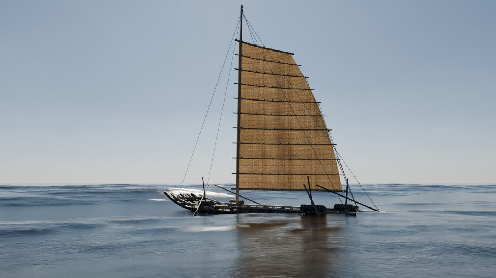

# Ciawolan

Bamboo, rattan and thatch, rebuilt in 3D: the boats and houses of the Amis coast, modelled piece by piece from photographs of the real ones.

## Models

Every culm, lashing, post and bundle of thatch is generated from a short written description, so each model can be taken apart, looked at part by part, and remade in another size or shape.

## Simulation

The models also float: load them, change their bamboo, and see how they sit in the water. A place to try out new boats before the first culm is cut.
